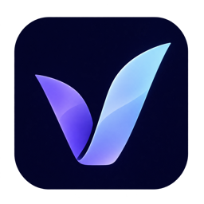

<p align="center">
  
</p>

<h1 align="center">Vela.Avalonia</h1>

<p align="center"><strong>Expressive controls. Thoughtful motion.</strong><br />A UI component library for Avalonia desktop applications.</p>

<p align="center">
  <a href="https://linsxyx.github.io/Vela.Avalonia/">Live gallery</a> ·
  <a href="https://www.nuget.org/packages/Vela.Avalonia">NuGet</a> ·
  <a href="https://github.com/Linsxyx/Vela.Avalonia/blob/master/docs/components.md">Components</a> ·
  <a href="https://github.com/Linsxyx/Vela.Avalonia/blob/master/README.zh-CN.md">简体中文</a>
</p>

<p align="center">
  <a href="https://www.nuget.org/packages/Vela.Avalonia"></a>
  
  
  <a href="https://github.com/Linsxyx/Vela.Avalonia/blob/master/LICENSE"></a>
</p>

Vela brings spring-driven interactions, coordinated light and dark themes, and desktop navigation into one component library. Use it for an application shell, a settings screen, a data workspace, or a few controls inside an existing Avalonia app.

## Explore it first

**[Open the interactive gallery →](https://linsxyx.github.io/Vela.Avalonia/)**

Try the controls, switch accents and themes, and explore the navigation and material options. The gallery supports English and Simplified Chinese. For native window and system-tray behavior, run the desktop gallery:

```bash
git clone https://github.com/Linsxyx/Vela.Avalonia.git
cd Vela.Avalonia
dotnet run --project samples/Vela.Avalonia.Gallery
```

## What makes Vela useful

- **Motion that responds to input.** Shared analytical springs preserve velocity when their target changes. A global reduced-motion option is available.
- **A coordinated theme.** Semantic design tokens, light and dark palettes, and eight accents keep controls, surfaces, and charts in sync.
- **An application shell.** Hierarchical navigation, tabs, a command palette, and configurable page caching help organize a desktop workspace.
- **Surfaces with depth.** Solid, frosted, glass-card, and liquid-glass treatments are available on supported controls, alongside animated shader backgrounds.
- **Data and visualization.** Lists, tables, trees, and six optional chart controls follow the same visual language.

## Quick start

Use an Avalonia **12.2** application targeting **.NET 10**. Keep the Avalonia packages in your app on the same version.

### 1. Install

```bash
dotnet add package Vela.Avalonia
dotnet add package Avalonia.Themes.Fluent --version 12.2.0

# Optional: charts
dotnet add package Vela.Avalonia.Charts
```

### 2. Add the theme

In `App.axaml`, place `VelaTheme` after `FluentTheme`. Replace `MyApp` with your application's namespace.

```xml
<Application xmlns="https://github.com/avaloniaui"
             xmlns:x="http://schemas.microsoft.com/winfx/2006/xaml"
             xmlns:vela="using:Vela.Avalonia"
             x:Class="MyApp.App"
             RequestedThemeVariant="Default">
  <Application.Styles>
    <FluentTheme />
    <vela:VelaTheme Accent="Violet" />
  </Application.Styles>
</Application>
```

### 3. Use the controls

A regular Avalonia `Window` works. For example, use this as `MainWindow.axaml`, keeping your app's existing `x:Class`:

```xml
<Window xmlns="https://github.com/avaloniaui"
        xmlns:x="http://schemas.microsoft.com/winfx/2006/xaml"
        xmlns:vela="using:Vela.Avalonia.Controls"
        x:Class="MyApp.MainWindow"
        Title="My Vela app" Width="480" Height="360"
        Background="{DynamicResource VelaBackgroundBrush}">
  <StackPanel Margin="32" Spacing="20">
    <TextBlock Text="Make yourself at home."
               FontSize="24" FontWeight="SemiBold"
               Foreground="{DynamicResource VelaForegroundBrush}" />
    <vela:VelaInput Label="Workspace name" PlaceholderText="My workspace" />
    <vela:VelaSwitch Content="Enable notifications" IsChecked="True" />
    <vela:VelaButton Content="Create workspace" Variant="Primary" />
  </StackPanel>
</Window>
```

The example demonstrates appearance and interaction; connect the button's `Command` to your application logic. `VelaWindow` is an optional window shell, not a prerequisite for the controls.

## Choose your components

| Area | Examples |
| --- | --- |
| Window & navigation | `VelaWindow`, `VelaTrayIcon`, `VelaNavigationView`, `VelaTabs`, `VelaCommandPalette` |
| Actions & forms | `VelaButton`, `VelaSwitch`, `VelaInput`, `VelaSelect`, `VelaDatePicker`, `VelaColorPicker` |
| Data views | `VelaListBox`, `VelaDataGrid`, `VelaTreeView`, `VelaTreeTable` |
| Layout & feedback | `VelaSettingsGroup`, `VelaResizablePanels`, `VelaDialogHost`, `VelaDrawerHost`, `VelaToastHost` |
| Surfaces & display | `VelaGlassCard`, `VelaLiquidGlass`, `VelaShaderBackground`, `VelaAvatar`, `VelaMetricCard` |
| Charts · optional package | `VelaLineChart`, `VelaBarChart`, `VelaDonutChart`, `VelaSparkline`, `VelaGauge`, `VelaActivityHeatmap` |

See the **[component catalog](https://github.com/Linsxyx/Vela.Avalonia/blob/master/docs/components.md)** for the complete list and links to working gallery examples. This README describes the current source; a published NuGet version may contain an earlier set of components.

## Theme and motion

The available accents are `Neutral`, `Violet`, `Blue`, `Green`, `Amber`, `Orange`, `Coral`, and `Rose`. `RequestedThemeVariant="Default"` follows the system's light/dark preference.

```csharp
using System.Linq;
using Avalonia;
using Vela.Avalonia;
using Vela.Avalonia.Motion;
using Vela.Avalonia.Tokens;

// Update appearance on the UI thread after the app has initialized.
var theme = Application.Current?.Styles.OfType<VelaTheme>().FirstOrDefault();
if (theme is not null)
    theme.Accent = VelaAccent.Blue;

// Set this from your app's accessibility or motion preference.
VelaMotionOptions.ReducedMotion = true;
```

## Platform notes

- **Desktop:** Windows, macOS, and Linux are the intended targets. Window chrome, tray menus, and popovers have platform-specific behavior.
- **Browser:** the WebAssembly gallery shares its UI with the desktop sample; desktop-only integrations are not available there.
- **Graphics:** shader and backdrop effects depend on the renderer and device. Check them on your target hardware; use simpler surfaces where appropriate.
- **Page caching:** `KeepAlive` preserves visited pages, `Lru` bounds the number retained, and `None` discards outgoing pages. Cached pages retain their state and resources.
- **Native AOT:** the libraries enable AOT compatibility analysis. Publish and test your host application for each target runtime before shipping.

## Development and contributions

```bash
dotnet build Vela.Avalonia.slnx -c Release
dotnet test tests/Vela.Avalonia.Tests/Vela.Avalonia.Tests.csproj -c Release
```

Build instructions, browser publishing, and release setup live in **[CONTRIBUTING.md](https://github.com/Linsxyx/Vela.Avalonia/blob/master/CONTRIBUTING.md)**. For bugs, include a small reproduction and your OS, .NET, Avalonia, and Vela versions in an **[issue](https://github.com/Linsxyx/Vela.Avalonia/issues)**.

## License

[MIT](https://github.com/Linsxyx/Vela.Avalonia/blob/master/LICENSE).
