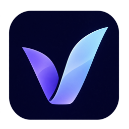

<p align="center">
  
</p>

<h1 align="center">Vela.Avalonia</h1>

<p align="center"><strong>让桌面界面自然地动起来。</strong><br />为 Avalonia 桌面应用提供统一的控件、主题和交互体验。</p>

<p align="center">
  <a href="https://linsxyx.github.io/Vela.Avalonia/">在线体验</a> ·
  <a href="https://www.nuget.org/packages/Vela.Avalonia">NuGet</a> ·
  <a href="https://github.com/Linsxyx/Vela.Avalonia/blob/master/docs/components.md">组件目录</a> ·
  <a href="https://github.com/Linsxyx/Vela.Avalonia/blob/master/README.md">English</a>
</p>

<p align="center">
  <a href="https://www.nuget.org/packages/Vela.Avalonia"></a>
  
  
  <a href="https://github.com/Linsxyx/Vela.Avalonia/blob/master/LICENSE"></a>
</p>

Vela 将弹簧动效、协调的浅色与深色主题、桌面导航整合到一个组件库中。你可以用它搭建应用外壳、设置页面或数据工作台，也可以只在已有 Avalonia 应用中使用几个控件。

## 先体验一下

**[打开交互式 Gallery →](https://linsxyx.github.io/Vela.Avalonia/)**

直接操作控件，切换强调色与明暗主题，体验导航和不同材质。Gallery 支持中文与英文。要体验原生窗口和系统托盘，请运行桌面示例：

```bash
git clone https://github.com/Linsxyx/Vela.Avalonia.git
cd Vela.Avalonia
dotnet run --project samples/Vela.Avalonia.Gallery
```

## Vela 提供什么

- **响应操作的动效。** 共用解析弹簧模型，动画中途改变目标时保留速度，并提供全局减少动态效果选项。
- **协调的主题。** 语义化设计令牌、明暗配色和八种强调色，让控件、材质和图表保持一致。
- **完整的导航骨架。** 层级导航、标签页、命令面板和可配置的页面缓存，用于组织桌面工作空间。
- **有层次的表面。** 支持这些材质的控件可选择实色、磨砂、玻璃卡片或液态玻璃，也可搭配动态着色器背景。
- **数据展示与可视化。** 列表、表格、树形控件，以及可选的六种图表，沿用同一套视觉语言。

## 快速开始

使用面向 **.NET 10** 的 **Avalonia 12.2** 应用，并保持应用内各 Avalonia 包的版本一致。

### 1. 安装

```bash
dotnet add package Vela.Avalonia
dotnet add package Avalonia.Themes.Fluent --version 12.2.0

# 可选：图表
dotnet add package Vela.Avalonia.Charts
```

### 2. 注册主题

在 `App.axaml` 中，将 `VelaTheme` 放在 `FluentTheme` 后面。把 `MyApp` 替换为应用的命名空间。

```xml
<Application xmlns="https://github.com/avaloniaui"
             xmlns:x="http://schemas.microsoft.com/winfx/2006/xaml"
             xmlns:vela="using:Vela.Avalonia"
             x:Class="MyApp.App"
             RequestedThemeVariant="Default">
  <Application.Styles>
    <FluentTheme />
    <vela:VelaTheme Accent="Violet" />
  </Application.Styles>
</Application>
```

### 3. 使用控件

普通 Avalonia `Window` 即可使用这些控件。例如，将下面内容放入 `MainWindow.axaml`，保留你应用原有的 `x:Class`：

```xml
<Window xmlns="https://github.com/avaloniaui"
        xmlns:x="http://schemas.microsoft.com/winfx/2006/xaml"
        xmlns:vela="using:Vela.Avalonia.Controls"
        x:Class="MyApp.MainWindow"
        Title="我的 Vela 应用" Width="480" Height="360"
        Background="{DynamicResource VelaBackgroundBrush}">
  <StackPanel Margin="32" Spacing="20">
    <TextBlock Text="开始你的工作空间。"
               FontSize="24" FontWeight="SemiBold"
               Foreground="{DynamicResource VelaForegroundBrush}" />
    <vela:VelaInput Label="工作空间名称" PlaceholderText="我的工作空间" />
    <vela:VelaSwitch Content="开启通知" IsChecked="True" />
    <vela:VelaButton Content="创建工作空间" Variant="Primary" />
  </StackPanel>
</Window>
```

这个示例展示控件的外观与交互；请将按钮的 `Command` 接到自己的业务逻辑。`VelaWindow` 是可选的窗口外壳，使用其他控件时不要求替换现有窗口。

## 按场景选择组件

| 场景 | 代表组件 |
| --- | --- |
| 窗口与导航 | `VelaWindow`、`VelaTrayIcon`、`VelaNavigationView`、`VelaTabs`、`VelaCommandPalette` |
| 操作与表单 | `VelaButton`、`VelaSwitch`、`VelaInput`、`VelaSelect`、`VelaDatePicker`、`VelaColorPicker` |
| 数据视图 | `VelaListBox`、`VelaDataGrid`、`VelaTreeView`、`VelaTreeTable` |
| 布局与反馈 | `VelaSettingsGroup`、`VelaResizablePanels`、`VelaDialogHost`、`VelaDrawerHost`、`VelaToastHost` |
| 材质与展示 | `VelaGlassCard`、`VelaLiquidGlass`、`VelaShaderBackground`、`VelaAvatar`、`VelaMetricCard` |
| 图表 · 独立可选包 | `VelaLineChart`、`VelaBarChart`、`VelaDonutChart`、`VelaSparkline`、`VelaGauge`、`VelaActivityHeatmap` |

完整列表和可运行示例入口见 **[组件目录](https://github.com/Linsxyx/Vela.Avalonia/blob/master/docs/components.md)**。本文描述当前源码，已发布的 NuGet 版本可能尚未包含部分新组件。

## 主题与动效

可选强调色：`Neutral`、`Violet`、`Blue`、`Green`、`Amber`、`Orange`、`Coral`、`Rose`。`RequestedThemeVariant="Default"` 会跟随系统的明暗主题偏好。

```csharp
using System.Linq;
using Avalonia;
using Vela.Avalonia;
using Vela.Avalonia.Motion;
using Vela.Avalonia.Tokens;

// 应用初始化后，在 UI 线程更新外观。
var theme = Application.Current?.Styles.OfType<VelaTheme>().FirstOrDefault();
if (theme is not null)
    theme.Accent = VelaAccent.Blue;

// 由应用的无障碍或动效偏好设置控制。
VelaMotionOptions.ReducedMotion = true;
```

## 平台与使用说明

- **桌面端：** 面向 Windows、macOS 和 Linux。窗口装饰、托盘菜单与弹出面板存在平台差异。
- **浏览器：** WebAssembly Gallery 与桌面示例共用界面，浏览器中不提供桌面专属集成能力。
- **图形效果：** 着色器和背景效果依赖渲染器与设备，请在目标硬件上验证，并按需选择较简单的材质。
- **页面缓存：** `KeepAlive` 保留已访问页面，`Lru` 限制缓存页数，`None` 在切换时丢弃原页面。缓存页面会保留状态和资源。
- **Native AOT：** 库已启用 AOT 兼容性分析；发布应用前，仍需针对各目标运行时完成宿主应用的发布与测试。

## 开发与贡献

```bash
dotnet build Vela.Avalonia.slnx -c Release
dotnet test tests/Vela.Avalonia.Tests/Vela.Avalonia.Tests.csproj -c Release
```

构建、浏览器发布与版本发布配置见 **[贡献指南](https://github.com/Linsxyx/Vela.Avalonia/blob/master/CONTRIBUTING.md)**。反馈问题时，请在 **[Issue](https://github.com/Linsxyx/Vela.Avalonia/issues)** 中提供最小复现，以及操作系统、.NET、Avalonia 和 Vela 版本。

## 许可证

[MIT](https://github.com/Linsxyx/Vela.Avalonia/blob/master/LICENSE)。
